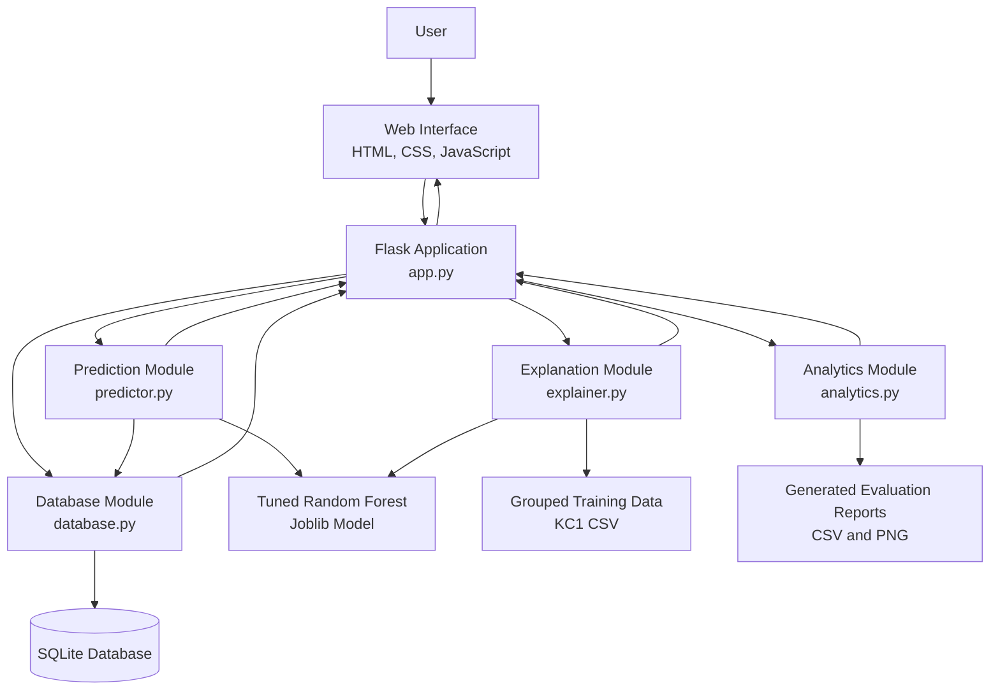

# System Architecture – Automated Software Bug and Defect Predictor

## 1. Introduction

The Automated Software Bug and Defect Predictor follows a modular architecture that separates data processing, machine learning, prediction, explainability, analytics and user interface components.

The system uses a trained machine learning model to estimate the probability that a software module belongs to the defective class. A Flask backend connects the prediction model with the web interface and stores prediction history using SQLite.

## 2. High-Level Architecture

The application consists of five main layers:

1. **Presentation Layer:** HTML, CSS and JavaScript provide the user interface.
2. **Application Layer:** Flask handles HTTP requests and coordinates application components.
3. **Machine Learning Layer:** The trained Random Forest pipeline generates defect predictions.
4. **Explainability and Analytics Layer:** SHAP explains individual predictions, while stored evaluation results support model analytics.
5. **Data Storage Layer:** SQLite stores prediction history, while model and dataset files are maintained locally.

## 3. Architecture Diagram

The following diagram represents the application's main components and their relationships.

## 4. Component Description

### 4.1 Presentation Layer

**Location:** `app/templates/` and `app/static/`

The frontend is developed using:

- HTML for page structure.
- CSS for styling and responsive layout.
- JavaScript for user interaction and API communication.

Main interface sections:

- Dashboard
- Defect Prediction
- Prediction History
- Model Insights
- Model Performance

JavaScript sends requests to Flask API endpoints and updates the interface with the returned results.

### 4.2 Application Layer

**File:** `app/app.py`

Flask acts as the central application controller.

It handles incoming requests, calls the appropriate modules and returns JSON responses or renders the web interface.

Main endpoints:

| Endpoint | Method | Purpose |
|---|---|---|
| `/` | GET | Displays the application |
| `/api/health` | GET | Checks application health |
| `/api/model-info` | GET | Returns model information |
| `/api/predict` | POST | Generates a defect prediction |
| `/api/history` | GET | Retrieves prediction history |
| `/api/explain` | POST | Generates an individual SHAP explanation |
| `/api/analytics` | GET | Retrieves model comparison and analytics |
| `/api/analytics/figure/<filename>` | GET | Serves an evaluation figure |

### 4.3 Prediction Module

**File:** `app/predictor.py`

The prediction module loads the selected tuned Random Forest model using Joblib.

The selected model was trained using the grouped KC1 dataset.

Its responsibilities include:

1. Loading the saved model pipeline.
2. Checking the supplied software metrics.
3. Arranging input features in the expected order.
4. Generating the defective-class probability.
5. Comparing the probability with the saved classification threshold.
6. Returning the predicted class and probability.

The deployed classification threshold is 0.47.

The prediction result is also assigned a display risk category based on the application's probability bands. These categories are interface labels and are not calibrated real-world risk levels.

### 4.4 Explainability Module

**File:** `app/explainer.py`

The explainability module uses SHAP to interpret individual Random Forest predictions.

It uses:

- The trained Random Forest classifier.
- The model's preprocessing pipeline.
- Grouped KC1 training data as the background dataset.

SHAP calculates feature-level contributions to the predicted defective-class probability.

The output includes:

- Baseline probability.
- Predicted probability.
- Positive feature contributions.
- Negative feature contributions.
- Feature contribution values.

Positive contributions increase the model's predicted defective-class probability, while negative contributions decrease it.

The sum of the baseline value and SHAP contributions is checked against the model's predicted probability.

### 4.5 Analytics Module

**File:** `app/analytics.py`

The analytics module retrieves previously generated model evaluation results and visualizations.

It reads comparison CSV files and makes selected evaluation figures available to the frontend.

The application displays:

- Model comparison results.
- Confusion matrix.
- ROC curve.
- Precision-recall curve.

These reports are generated during the model training and tuning workflow rather than being recalculated for every web request.

### 4.6 Database Module

**File:** `app/database.py`

SQLite is used to maintain prediction history.

The `prediction_history` table stores information such as:

- Prediction ID.
- Prediction timestamp.
- Predicted class.
- Defect probability.
- Classification threshold.
- Display risk category.
- Submitted software metrics.

The database allows users to view previous predictions through the application.

## 5. Machine Learning Development Workflow

The machine learning development process is separate from the Flask application's prediction workflow.

The development process consists of:

1. Loading the NASA KC1 dataset.
2. Converting ARFF data into structured tabular data.
3. Cleaning and validating the features and target.
4. Creating ordinary and grouped training/testing splits.
5. Training four classification algorithms.
6. Evaluating baseline model performance.
7. Performing hyperparameter tuning.
8. Selecting classification thresholds using out-of-fold training predictions.
9. Evaluating tuned models.
10. Saving the trained model and evaluation reports.

Main source directories:

- `src/data/` – Dataset inspection, preprocessing and splitting.
- `src/models/` – Model training, tuning and global explainability.

The selected tuned model is saved as a Joblib artifact and loaded by the prediction module.

## 6. Prediction Request Workflow

When a user submits software metrics:

1. The frontend collects the 21 metric values.
2. JavaScript sends them to the `/api/predict` endpoint.
3. Flask forwards the input to the prediction module.
4. The prediction module validates the metrics and loads the trained pipeline.
5. The model calculates the probability of the defective class.
6. The probability is compared against the saved threshold.
7. The prediction and submitted metrics are stored in SQLite.
8. Flask returns the result to the frontend.
9. The frontend displays the predicted class, probability and other result details.

The frontend subsequently requests the `/api/explain` endpoint to display the individual SHAP explanation.

## 7. Technology Stack

| Component | Technology |
|---|---|
| Programming language | Python |
| Web framework | Flask |
| Frontend | HTML, CSS, JavaScript |
| Machine learning | Scikit-learn |
| Explainable AI | SHAP |
| Data processing | Pandas, NumPy, SciPy |
| Model serialization | Joblib |
| Database | SQLite |
| Visualization | Matplotlib |

## 8. Design Considerations

The application uses a modular structure to keep responsibilities separate.

- Prediction logic is separated from Flask route handling.
- Explainability is implemented independently of prediction logic.
- Database operations are handled through a dedicated module.
- Model analytics are separated from model training.
- The trained model is loaded from a saved artifact instead of being retrained for every prediction.
- Evaluation reports are reused by the web application.

This structure makes the application easier to maintain, test and extend.

## 9. Limitations

- The deployed model is based on the KC1 dataset.
- Prediction quality may differ on software projects with different characteristics.
- The application does not directly inspect source code.
- SHAP explains the behaviour of the trained model, not the actual causes of defects.
- Model analytics depend on previously generated evaluation reports.
- The application is intended as an academic decision-support prototype.

## 10. Conclusion

The architecture integrates machine learning, explainable AI, web technologies and local database storage into a single software defect prediction application.

The modular design separates model development from application execution, allowing the trained model to be used for interactive predictions while providing explanations, evaluation results and prediction history.
